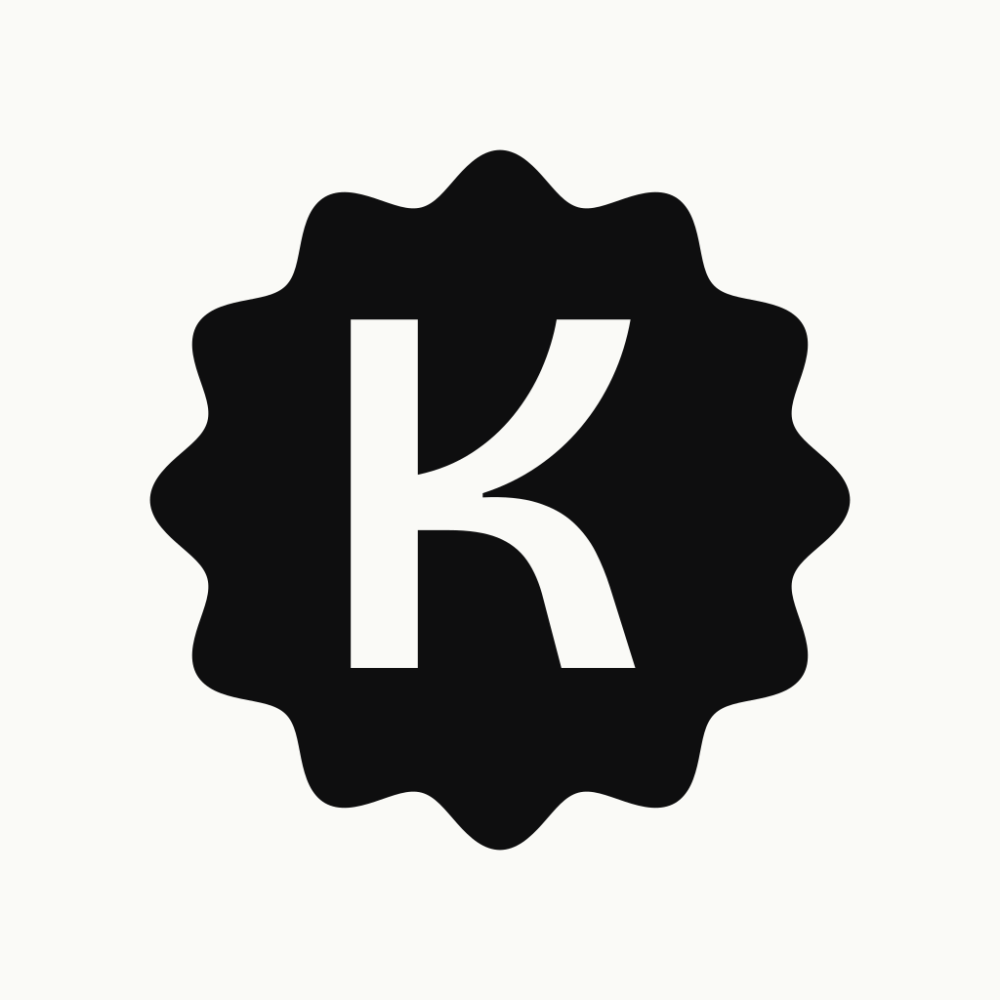
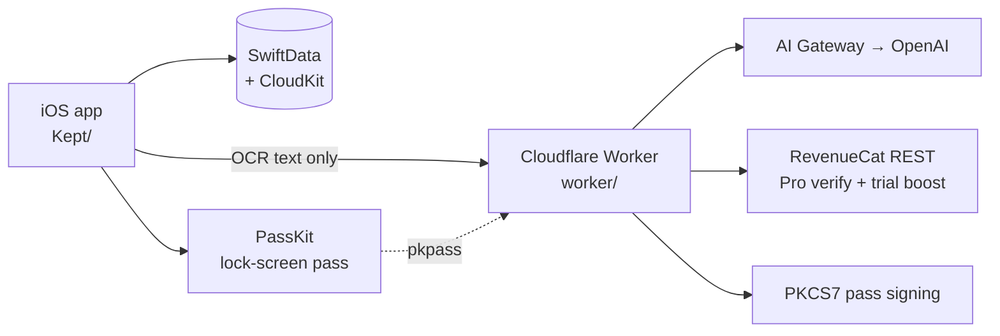

<p align="center">
  
</p>

<h1 align="center">Kept</h1>

<p align="center">Keep the receipt. Keep the warranty.</p>

Most people lose a receipt the week after they buy something, then rediscover it months later when the thing breaks and the shop asks for proof. By then the paper is a creased ball at the bottom of a drawer and the warranty is already a question.

Kept scans a receipt once and holds the proof — merchant, items, price, return window, warranty — for the day you actually need it. A live countdown sits on your lock screen through Apple Wallet, nudges arrive before coverage ends, and a one-page claim pack is ready to send to the seller.

## Try it

- **App Store:** https://apps.apple.com/gb/app/kept-warranty-tracker/id6797898011

There is no web build. Kept scans receipts on-device and binds reminders to the iPhone it was captured on.

## How it uses AI, Apple Wallet, and iPhone Duo

**AI**

- **On-device OCR first.** Vision reads every line of the receipt on the phone; the image never leaves the device. Only the recognised text goes to the extraction worker.
- **Structured extraction.** The Cloudflare Worker calls an OpenAI model through AI Gateway with a strict JSON schema (`worker/src/schema.ts`) — merchant, items, total, currency, purchase date, warranty duration, return window, confidence. One corrective retry when the model drifts off schema.
- **Deterministic itemName.** The worker builds the displayed label from `items[]` in code rather than trusting the model: one item renders verbatim, two or more render as `"{highest-priced item}, +N more"`, and grocery / restaurant / fuel baskets keep their summary.
- **Pro tier upgrade.** Verified Pro customers route to `LLM_MODEL_PRO` (default `openai/gpt-4o`); free customers use `LLM_MODEL` (default `openai/gpt-4o-mini`). RevenueCat's REST API decides.
- **Foundation Models fallback.** On iOS 26+ an on-device model fills in warranty hints when the network extraction is weak, so a bad signal still yields something usable.

**Apple Wallet**

- **Live countdown pass.** Each saved receipt can be added to Apple Wallet as a pass whose primary field counts down to the coverage end — "28 days left", "Expires today", "Expired 4d ago" — and re-themes on the way: calm, urgent, expired.
- **Worker-signed.** The same Cloudflare Worker signs the `.pkpass` with PKCS7 using the pass type certificate chain (`SIGNER_CERT_PEM`, `SIGNER_KEY_PKCS8_PEM`, `WWDR_PEM`). The app never ships signing keys.
- **Updates when the deadline moves.** Editing the warranty length in Kept re-signs the pass so the lock-screen countdown stays in step.

**iPhone Duo**

- **Both panels.** The cover screen keeps the single-column Library. The inner display reports regular width and gets a `NavigationSplitView` — receipts grid on the left, selected receipt on the right.
- **Splash centres against the physical display.** The Duo reserves a hinge region in the safe area, so the splash lockup lifts its `.ignoresSafeArea()` to the ZStack and sits dead centre regardless of posture.
- **Standard components, not hand-rolled.** Toolbars, sidebar collapse and detail routing are all system `NavigationSplitView` behaviour, so adapting cost one file.

## Built with

| Tool | What it does in Kept |
|---|---|
| **SwiftUI** (iOS 18+) | Every screen. `NavigationSplitView` on wide displays, `SwiftData` for the receipt store, matched-geometry zoom into detail, Metal shader for the capture shimmer |
| **SwiftData + CloudKit** | The receipt store syncs across the user's devices through `NSPersistentCloudKitContainer`. No server-side user database |
| **Vision** | On-device OCR of the receipt photo. The image never leaves the phone |
| **Foundation Models** (iOS 26+) | On-device fallback for warranty hints when network extraction is weak |
| **PassKit** | Builds and installs the `.pkpass` the worker signs — the live coverage countdown on the lock screen |
| **RevenueCat** | StoreKit 2 subscription with iCloud user record id as `appUserID`, so Pro status follows the Apple ID across devices |
| **Cloudflare Workers + AI Gateway** | TypeScript worker that extracts receipts (`/extract`), signs Wallet passes, and grants the trial-boost entitlement via RevenueCat's REST API |
| **OpenAI** (`gpt-4o-mini` free / `gpt-4o` Pro) | The extraction model, called through AI Gateway. One corrective retry on schema drift |
| **Bricolage Grotesque** | The product typeface across the app, Wallet pass and claim pack |
| **XCTest** | The iOS test suite — extraction accuracy harness, coverage logic, reminder planner, paywall catalog, onboarding flow |

No third-party iOS dependencies beyond RevenueCat.

## Architecture



The phone does the OCR, the worker does the structured interpretation, and nothing but the recognised text crosses the network. The pass signing lives in the same worker so the `.pkpass` is built from the same extracted fields it was created with.

| Path | What it is |
|---|---|
| `Kept/` | The iOS app — `App/`, `Features/` (Capture, Library, Extraction, Wallet, ClaimPack, Settings, Subscription, Onboarding, Splash), `Services/`, `Models/`, `DesignSystem/` |
| `KeptTests/` | XCTest suites — extraction accuracy, coverage logic, reminder planner, paywall catalog, onboarding flow, receipt image import |
| `worker/` | Cloudflare Worker — `index.ts` routes, `llm.ts` extraction loop, `schema.ts` structured output, `prompt.ts` extraction prompt, `pass.ts` + `passAssets.ts` Wallet pass signing, `proVerification.ts` + `trialBoost.ts` RevenueCat integration |
| `Config/` | xcconfig files (real values gitignored, `.example` files checked in) |
| `docs/` | Deep-link setup (`DEEP_LINKS.md`), AASA content, retention copy |

## Running locally

### iOS

Needs **Xcode 27.0+** and an iOS 18+ simulator or device. The iOS 26 features (Foundation Models fallback, iPhone Duo adaptivity) are gated behind `@available`, so iOS 18 devices get the base experience.

```sh
git clone https://github.com/tade-dev/Kept.git
cd Kept
cp Config/Extract.xcconfig.example Config/Extract.local.xcconfig
cp Config/RevenueCat.xcconfig.example Config/RevenueCat.xcconfig
open Kept.xcodeproj
```

Fill `Extract.local.xcconfig` with your extract secret (if talking to a hosted worker) and `RevenueCat.xcconfig` with your RevenueCat iOS public API key. Both files are gitignored. Pick a simulator and ⌘R.

To see the Duo split-pane layout, pick **iPhone Duo** in Device Hub and use the fold buttons at the bottom of its window.

### Worker

Needs **Node 20+** and the `wrangler` CLI.

```sh
cd worker
npm install
wrangler dev
```

Health check: `GET /v1/health`. Required secrets (`wrangler secret put <NAME>`, never committed):

| Secret | What it's for |
|---|---|
| `EXTRACT_SECRET` | Shared secret the iOS app sends on `/extract` |
| `OPENAI_API_KEY` | OpenAI key used through AI Gateway |
| `RC_SECRET_KEY` | RevenueCat REST key, used to verify Pro and grant the trial boost |
| `SIGNER_CERT_PEM` | Apple Pass Type certificate (PEM) |
| `SIGNER_KEY_PKCS8_PEM` | Private key for the pass type cert, in PKCS8 PEM |
| `WWDR_PEM` | Apple WWDR intermediate certificate (PEM) |
| `CF_AIG_TOKEN` | Optional, only if AI Gateway auth is enabled |

Public vars live in `worker/wrangler.toml`: AI Gateway id, free and Pro model names, pass type identifier, team identifier, RevenueCat entitlement id.

## Tests

```sh
xcodebuild test -project Kept.xcodeproj -scheme Kept \
  -destination 'platform=iOS Simulator,name=iPhone 18 Pro'
```

The suite covers extraction accuracy against a fixture library, coverage countdown logic, reminder scheduling, paywall catalog resolution, onboarding flow, and receipt image import. The accuracy harness measures the merge between on-device OCR and the worker's structured response against known-good fixtures.

## Licence

MIT, an OSI-approved licence. See [LICENSE](LICENSE).

## Credits

Designed and built in 2026 by **Akintade Oluwaseun**, with heavy [Claude Code](https://claude.com/claude-code) pair-programming — architecture, code and copy iterated with the model. Shipping cadence and product decisions are mine; the model is a fast, patient collaborator.
